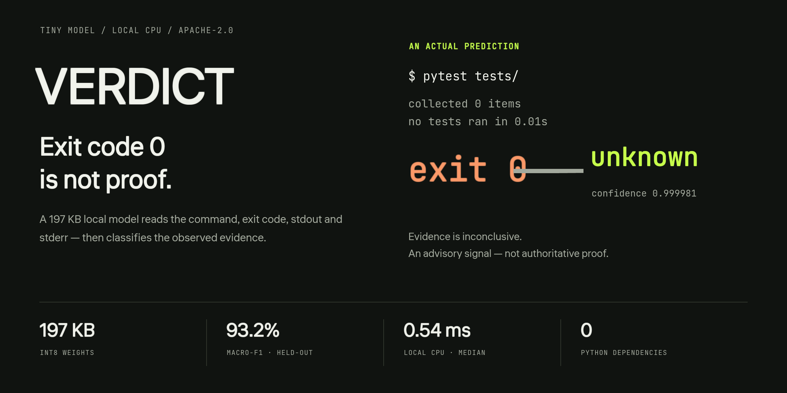
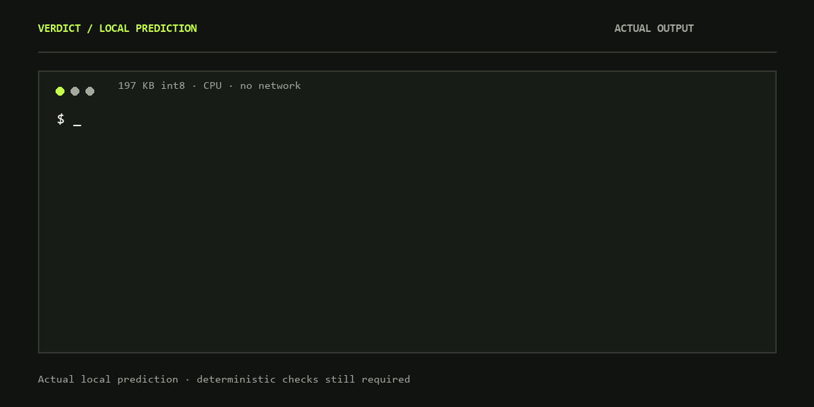
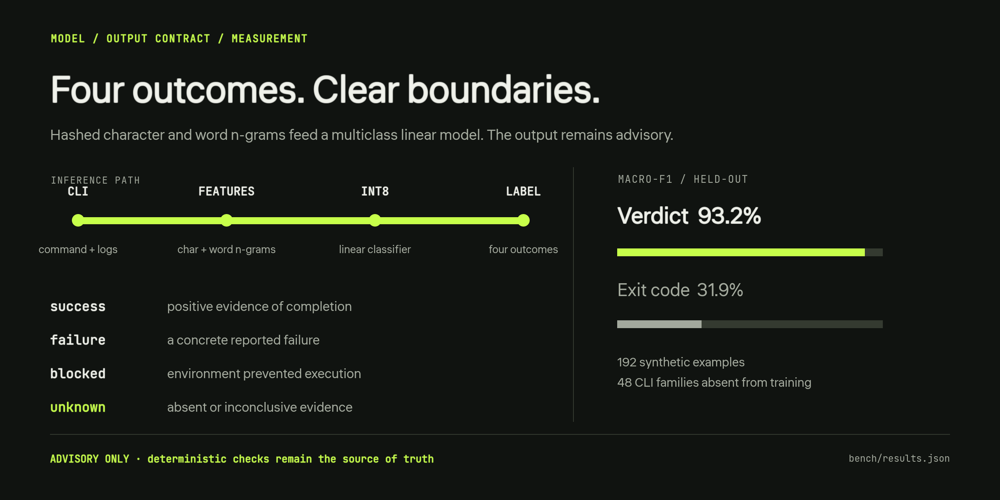

<div align="center">
  
  <p><strong>A 197 KB local semantic outcome classifier for CLI tool calls.</strong></p>
  <p><code>success</code> · <code>failure</code> · <code>blocked</code> · <code>unknown</code></p>
  <p>
    <a href="#install-and-run">Install and run</a> ·
    <a href="#benchmark">Benchmark</a> ·
    <a href="#model">Model</a> ·
    <a href="#output-contract">Output contract</a> ·
    <a href="https://balanov.pro/research/verdict/">Browser demo</a> ·
    <a href="README_RU.md">Русский</a>
  </p>
  <p>
    <a href="pyproject.toml"></a>
    <a href="LICENSE"></a>
    <a href="https://huggingface.co/BalanovAN/verdict"></a>
  </p>
</div>

<div align="center">
  
  <p><sub>An actual local prediction; selected output fields are shown. Verdict reads the evidence rather than trusting the process exit code.</sub></p>
</div>

Verdict is a research preview of a semantic outcome layer for coding agents, CI runners, and tool-using systems. It looks beyond the process exit code and reads the command, stdout, and stderr. Inference runs locally on CPU with **no Python dependencies**.

> **Important:** Verdict is an advisory classifier, not proof that a task or environment mutation completed. Keep deterministic checks and authoritative state verification as the source of truth.

## Why

A process can exit successfully while running zero tests, returning an HTTP 500, waiting for a worker, or producing incomplete output. Conversely, a non-zero exit can describe an environment blocker rather than a failed assertion. Agents need that distinction before they retry, stop, or claim completion.

## Benchmark

Evaluated on **192 synthetic examples from 48 CLI families entirely absent from training**. Training used 1,440 synthetic examples from 60 different families.

| Model | Accuracy | Macro-F1 | Size | Median inference |
|---|---:|---:|---:|---:|
| **Verdict 0.1 (int8)** | **93.2%** | **93.2%** | **197 KB** | **0.54 ms** |
| Exit-code baseline | 47.9% | 31.9% | — | — |

Latency is the median of 576 predictions on Windows 11 / AMD64 / Python 3.12, including feature extraction and the Python API call. These are reproducibility measurements, not cross-hardware promises. See [`bench/results.json`](bench/results.json) and reproduce with `python training/train.py`.

**The corpus is synthetic and English-biased.** The benchmark measures generalization across held-out templates, not reliability on production agent traces. Real-trace validation is the next milestone.

<div align="center">
  
  <p><sub>The mechanism, output contract and measurement context. <a href="bench/results.json">Raw benchmark data</a> · <a href="#reproduce">Reproduce the model</a>.</sub></p>
</div>

## Install and run

```bash
git clone https://github.com/Balanov/verdict.git
cd verdict
python -m pip install .
```

```python
from verdict_tiny import Verdict

model = Verdict()
result = model.predict(
    command="pytest tests/",
    exit_code=0,
    stdout="collected 0 items\nno tests ran in 0.01s",
)
print(result)
```

```json
{
  "label": "unknown",
  "confidence": 0.999981,
  "probabilities": {
    "success": 0.000019,
    "failure": 0.0,
    "blocked": 0.0,
    "unknown": 0.999981
  },
  "advisory": true
}
```

### CLI

```bash
printf 'collected 0 items\nno tests ran\n' | verdict \
  --command 'pytest tests/' --exit-code 0
```

Use `--stdout output.log`, `--stderr error.log`, and `--weights /path/to/verdict-q8.bin` when needed.

### Browser demo

The [project page](https://balanov.pro/research/verdict/) runs the same quantized weights in your browser. Logs are not uploaded.

## Output contract

| Label | Meaning |
|---|---|
| `success` | Output contains positive evidence that the operation completed. |
| `failure` | The operation ran and reported a concrete failure. |
| `blocked` | Permissions, dependencies, network, quota, or environment prevented execution. |
| `unknown` | Evidence is absent, incomplete, skipped, dry-run-only, or otherwise inconclusive. |

Probabilities come from a linear multiclass model and are not calibrated confidence in a safety-critical sense. Use thresholds and human or deterministic review for consequential actions.

## Model

- **Architecture:** hashed character 3–5-grams and word 1–3-grams → multiclass logistic regression.
- **Parameters:** 196,608 int8 weights plus four biases and per-class scales.
- **Input:** command, exit code, stdout, stderr; UTF-8 text, bounded to 12,288 characters per output stream with explicit head/tail clipping.
- **Runtime:** pure Python standard library; no tokenizer files, GPU, network calls, or telemetry.
- **Weights:** [`weights/verdict-q8.bin`](weights/verdict-q8.bin), also on [Hugging Face](https://huggingface.co/BalanovAN/verdict).

Verdict is deliberately narrow: it classifies observed CLI evidence; it does not judge task completion, code correctness, safety, or truthfulness.

## Reproduce

```bash
python -m pip install -e '.[train,dev]'
python training/train.py
pytest -q
```

The training script regenerates the public corpus, trains from scratch, exports int8 weights, evaluates the quantized artifact, and writes benchmark metrics.

## Repository layout

```text
assets/              logo and editable vector source
bench/               measured metrics
data/                synthetic train and held-out test JSONL (CC0)
src/verdict_tiny/    zero-dependency inference and CLI
training/            corpus, features, training and export
weights/             release weights and config
site/                multilingual research page and browser demo
```

## License

Code and model weights: **Apache-2.0**. Synthetic dataset: **CC0-1.0**. Fork it, modify it, ship it. See [`LICENSE`](LICENSE) and [`data/LICENSE`](data/LICENSE).

## Cite

```bibtex
@misc{balanov2026verdict,
  title  = {Verdict: Tiny Semantic Outcome Verification for AI Agents},
  author = {Balanov, Anton},
  year   = {2026},
  url    = {https://balanov.pro/research/verdict/}
}
```
