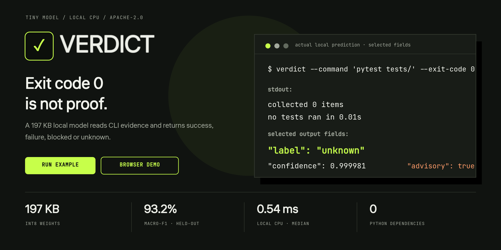
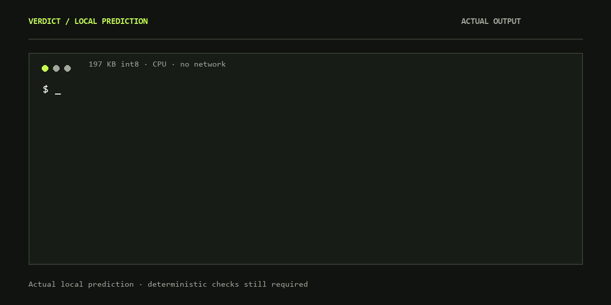
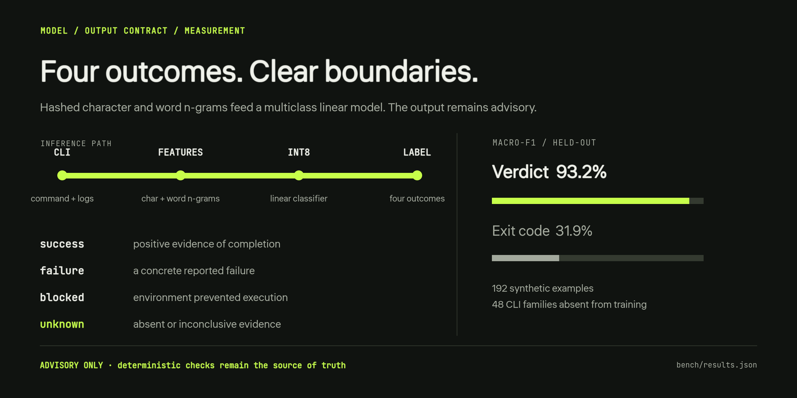

<div align="center">
  
  <p><strong>Локальная модель размером 197 КБ для семантической классификации результата CLI-вызова.</strong></p>
  <p><a href="README.md">English</a> · <a href="#запуск">Запуск</a> · <a href="#четыре-результата">Четыре результата</a> · <a href="#измерения">Измерения</a> · <a href="https://balanov.pro/research/verdict/">Демо в браузере</a></p>
</div>

Краткое русское введение. Полная документация, структура репозитория, BibTeX и ограничения — в [английском README](README.md).

## Зачем нужен Verdict

Код выхода `0` не всегда означает успешное выполнение: команда могла запустить ноль тестов, получить HTTP 500 или вернуть неполный вывод. Обратная ситуация тоже возможна: ненулевой код может означать блокировку окружения, а не провал утверждения.

Verdict читает команду, код выхода, stdout и stderr и возвращает один из четырёх классов. Inference работает локально на CPU и не требует сторонних Python-зависимостей, сети, GPU, токенизатора или телеметрии.

> **Важно:** это advisory-классификатор, а не доказательство выполнения задачи или изменения среды. Детерминированные проверки и авторитетная проверка состояния остаются источником истины.

<div align="center">
  
  <p><sub>Настоящий локальный результат; показаны выбранные поля вывода.</sub></p>
</div>

## Запуск

Требуется Python 3.10+:

```bash
git clone https://github.com/Balanov/verdict.git
cd verdict
python -m pip install .
```

```python
from verdict_tiny import Verdict

model = Verdict()
result = model.predict(
    command="pytest tests/",
    exit_code=0,
    stdout="collected 0 items\nno tests ran in 0.01s",
)
print(result)
```

В этом примере локальная модель вернула:

```json
{
  "label": "unknown",
  "confidence": 0.999981,
  "probabilities": {
    "success": 0.000019,
    "failure": 0.0,
    "blocked": 0.0,
    "unknown": 0.999981
  },
  "advisory": true
}
```

CLI:

```bash
printf 'collected 0 items\nno tests ran\n' | verdict \
  --command 'pytest tests/' --exit-code 0
```

## Четыре результата

| Класс | Значение |
| --- | --- |
| `success` | Вывод содержит положительные доказательства завершения операции |
| `failure` | Операция выполнялась и сообщила конкретную ошибку |
| `blocked` | Права, зависимости, сеть, квота или окружение помешали выполнению |
| `unknown` | Доказательства отсутствуют, неполны, пропущены или не дают однозначного вывода |

Вероятности производятся линейной многоклассовой моделью и не являются откалиброванной уверенностью для safety-critical решений.

<div align="center">
  
</div>

## Как устроена модель

- Хэшированные символьные 3–5-граммы и словесные 1–3-граммы.
- Многоклассовая логистическая регрессия.
- 196 608 весов int8, четыре смещения и масштабы классов.
- Вход: команда, код выхода, stdout и stderr; до 12 288 символов на поток с явным head/tail clipping.
- Веса: [`weights/verdict-q8.bin`](weights/verdict-q8.bin) и [Hugging Face](https://huggingface.co/BalanovAN/verdict).

Verdict намеренно узкий: он классифицирует наблюдаемые CLI-доказательства, но не оценивает правильность кода, истинность, безопасность или фактическое завершение всей задачи.

## Измерения

Оценка проведена на **192 синтетических примерах из 48 CLI-семейств, полностью отсутствовавших в обучении**. Обучение использовало 1 440 примеров из 60 других семейств.

| Модель | Accuracy | Macro-F1 | Размер | Медианный inference |
| --- | ---: | ---: | ---: | ---: |
| **Verdict 0.1 (int8)** | **93,2 %** | **93,2 %** | **197 КБ** | **0,54 мс** |
| Exit-code baseline | 47,9 % | 31,9 % | — | — |

Медиана рассчитана по 576 предсказаниям на Windows 11 / AMD64 / Python 3.12, включая извлечение признаков и вызов Python API. Это воспроизводимые локальные измерения, а не обещание производительности на другом оборудовании.

**Корпус синтетический и смещён в сторону английского языка.** Benchmark измеряет обобщение на held-out шаблонах, а не надёжность на production-трассах агентов. Следующий этап — проверка на реальных трассах.

Исходные данные: [`bench/results.json`](bench/results.json). Воспроизведение:

```bash
python -m pip install -e '.[train,dev]'
python training/train.py
pytest -q
```

Код и веса: [Apache-2.0](LICENSE). Синтетический набор данных: [CC0-1.0](data/LICENSE).
